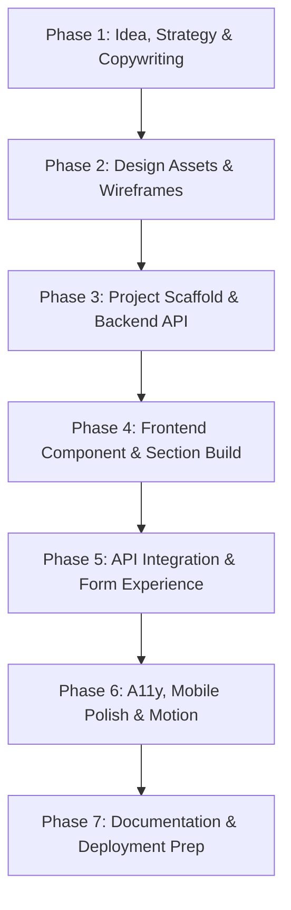

# Task 4: Ideate Landing Page — Phase-Wise Execution Plan

This execution plan maps out the end-to-end development of the **Ideate Landing Page (100 pts)** based on [task4-ideate-landing-PLAN.md](file:///d:/GitHub/TECH-Task-4/plan/task4-ideate-landing-PLAN.md) and the UI styling reference from [ref/WhatsApp Image 2026-10-23 at 20.21.16.jpeg](file:///d:/GitHub/TECH-Task-4/ref/WhatsApp%20Image%202026-10-23%20at%2020.21.16.jpeg).

---

## UI Reference & Design System Extraction

From the design reference card (**Combo 05**):
* **Primary Plum:** `#381932` — Deep, luxurious velvet plum tone (used for rich dark backgrounds, header typography, cards, and contrasting accents).
* **Primary Milk / Cream:** `#FFF3E6` — Soft, warm milk tone (used for crisp background contrast, warm card surfaces, badges, and glow effects).
* **Supporting Accents:**
  * **Amethyst Tint:** `#5A2950` / `#6E3362` (subtle borders, hover states, gradients)
  * **Warm Gold / Apricot:** `#E69D67` (accent highlights, CTA emphasis, badge borders)
  * **Deep Night Plum:** `#230E20` (high-contrast surfaces and dark-mode backdrop)
  * **Muted Cream:** `#EEDCC9` (subtext and secondary text on dark surfaces)
* **Typography & Vibe:** Modern editorial tech aesthetic (Outfit / Plus Jakarta Sans + Inter) with clean borders, micro-interactions, subtle glassmorphism, and responsive layouts.

---

## Phase-by-Phase Roadmap

---

### Phase 1: Product Selection, Value Proposition & Copy Deck
* **Objective:** Establish the product concept that maximizes the score under the "Ideate" criteria (clarity of problem, feasibility, audience relevance).
* **Recommended Idea:** **"CollabPulse / TeamSync" — The Smart Hackathon & Fest Project Teammate Finder for College Students** *(Addresses the genuine pain point of finding complementary teammates across design, code, and pitching during college techfests).*
* **Deliverables:**
  * Define audience, value proposition formula, and core conversion metrics in `design/rationale.md`.
  * Write complete, persuasive copy with zero *lorem ipsum* in `design/copy.md` (Hero, Problem, Solution, Steps, Early Tester Proof, FAQs, CTAs).

---

### Phase 2: Design Assets, Color Tokens & Wireframes
* **Objective:** Translate the Plum & Milk color identity into concrete design tokens, wireframe schematics, and interactive mockup assets.
* **Deliverables:**
  * Setup Tailwind CSS custom theme palette (`plum`, `milk`, `amethyst`, `apricot`).
  * Create desktop & mobile SVG wireframe blueprints in `design/wireframes/` showing low-fi to mid-fi evolution.
  * Generate high-fidelity visual mockups of the product dashboard preview for the Hero section.

---

### Phase 3: Project Scaffolding & Backend Setup
* **Objective:** Setup a clean, monorepo-friendly project structure ready for Vercel deployment.
* **Deliverables:**
  * Setup root `package.json` with Express, CORS, Rate Limit, and Zod.
  * Implement `api/index.js` with:
    * `GET /api/health`
    * `POST /api/signup` (validated with Zod, rate-limited, stores signups in memory/timestamped ledger).
  * Configure `vercel.json` for serverless API routing + client static SPA rewrites.
  * Scaffold `client/` using Vite + React + Tailwind CSS + Framer Motion + Lucide Icons.

---

### Phase 4: Frontend Sections & UI Component Build
* **Objective:** Build a pixel-perfect, highly responsive landing page matching modern design standards.
* **Sections to Build:**
  1. **Navbar:** Sticky glassmorphism header with logo, navigation anchors, live status pill, and "Join Waitlist" quick-jump button.
  2. **Hero:** High-impact plum-to-night gradient hero, value prop headline, subtext, live inline waitlist input with instant feedback, and floating interactive feature preview card.
  3. **Problem Space:** 3 friction points ("Ghosted on WhatsApp groups", "Mismatched skillsets", "Last-minute scramble").
  4. **Solution & Core Features:** Bento-style grid with interactive tabs (Smart Skill Matching, Vetted Hackathon Badges, Instant Pitch Chat).
  5. **Interactive Teammate Match Preview:** A live mini-interactive widget allowing visitors to toggle roles (Frontend, AI/ML, Design) and see mock match scores.
  6. **How It Works:** 3-step visual sequence (Profile setup & proof of work → Algorithmic match → 1-click squad formation).
  7. **Early Proof & Validation:** Credible early tester feedback, campus distribution stats, and university badges.
  8. **FAQ Accordion:** Expandable accordion addressing security, launch timing, college fest eligibility, and pricing.
  9. **Final CTA:** High-contrast Milk-on-Plum banner with subscriber counter and instant email capture.
  10. **Footer:** Brand identity, navigation columns, developer credit, and system status indicator.

---

### Phase 5: Client-Server Integration & Form UX
* **Objective:** Provide a seamless, bulletproof signup experience.
* **Deliverables:**
  * `client/src/lib/api.js` client fetcher with fallback resilience.
  * Form state machine: idle, loading spinner, error message (invalid email / rate limit), and animated success state with confetti/confirmation modal.
  * Real-time duplicate entry handling and local storage persistence for returning users.

---

### Phase 6: Motion, Polish & Accessibility Audit
* **Objective:** Elevate visual quality and ensure Lighthouse compliance.
* **Deliverables:**
  * Subtle entrance scroll animations using Framer Motion (fade-up, staggered cards, smooth accordion toggles).
  * WCAG AA contrast check between Plum `#381932` and Milk `#FFF3E6`.
  * Full responsiveness testing on Mobile (360px–420px), Tablet (768px), and Wide Desktop (1440px).
  * Meta tags, OpenGraph social card tags, favicon, and SEO title tags.

---

### Phase 7: Documentation, Rationale & Final Handover
* **Objective:** Present a complete submission package fulfilling every rubric point for 100/100.
* **Deliverables:**
  * `README.md` following the exact skeleton in the plan (Idea, Target User, Conversion Strategy, Design Rationale, A/B Testing Hypotheses, Local Run Guide).
  * `design/rationale.md` detailing UX decisions, color psychology of Plum & Milk, and conversion funnel strategy.
  * Verified build check (`npm run build` passing with 0 warnings).
